

  

  
  
  
  
  


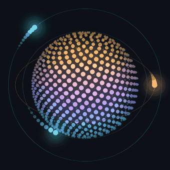

**AI Engineer at [Cloud202](https://cloud202.com)** since Sep 2026, working on governance and safety for agentic AI systems on AWS. Before that, about two years as a full-stack engineer at **Accenture**, modernizing enterprise Java systems for a Fortune 500 financial services client.

- 🛡️ **Agent safety:** guard models that check a tool call before it runs, red-team suites, policy-aware agents
- 🧪 **Evaluation first:** the test plan and thresholds are written before the model, with confidence intervals on every headline number
- 🔎 **RAG that declines:** cited answers from source text, and a plain "not covered" instead of a guess
- 🧠 **Fine-tuning:** LoRA / QLoRA on Gemma, Mistral and small routers that run in a browser
- 🚀 **Shipping:** FastAPI, MCP servers, LangGraph, and free-tier deploys on Hugging Face, GitHub Pages and Cloudflare

 


  
  
  
  
  
  
  
  
  
  
  
  

<a href="https://github.com/brej-29/agent-govbench"></a>

<table>
  <tr>
    <td width="50%" valign="top">
      <a href="https://github.com/brej-29/agent-govbench"></a>
      
<a href="https://github.com/brej-29/agent-govbench">Code</a> · <a href="https://huggingface.co/datasets/BrejBala/agent-govbench">Dataset</a>

    </td>
    <td width="50%" valign="top">
      <a href="https://github.com/brej-29/toolcall-guard"></a>
      
<a href="https://brej-29.github.io/toolcall-guard/">Live playground</a> · <a href="https://github.com/brej-29/toolcall-guard">Code</a>

    </td>
  </tr>
  <tr>
    <td width="50%" valign="top">
      <a href="https://github.com/brej-29/rag-agent-workbench"></a>
      
<a href="https://brej-29.github.io/rag-agent-workbench/">Live app</a> · <a href="https://github.com/brej-29/rag-agent-workbench">Code</a>

    </td>
    <td width="50%" valign="top">
      <a href="https://github.com/brej-29/mozhi"></a>
      
<a href="https://brej-29.github.io/mozhi/">Try it in the browser</a> · <a href="https://github.com/brej-29/mozhi">Code</a>

    </td>
  </tr>
  <tr>
    <td width="50%" valign="top">
      <a href="https://github.com/brej-29/feasible-day"></a>
      
<a href="https://brejbala-feasible-day.static.hf.space">Live app</a> · <a href="https://github.com/brej-29/feasible-day">Code</a>

    </td>
    <td width="50%" valign="top">
      <a href="https://github.com/brej-29/fraud-anomaly-lab"></a>
      
<a href="https://brej-29.github.io/fraud-anomaly-lab/">Live workbench</a> · <a href="https://github.com/brej-29/fraud-anomaly-lab">Code</a>

    </td>
  </tr>
</table>

<b>🧩 More live projects</b> (click to expand)

 

| | Project | What it does | Open |
|:-:|---|---|---|
| 🦺 | **[SafetyOps Copilot](https://github.com/brej-29/safetyops-copilot)** | Turns a safety observation into an explainable assessment, an owned corrective action and a shift handover. Read-only MCP tools. | [Live](https://safetyops-api-a5afr3rcdq-as.a.run.app/) |
| 📉 | **[Customer Churn MLOps](https://github.com/brej-29/customer-churn-mlops)** | Quality-gated XGBoost champion, FastAPI contracts, SHAP-grounded LLM explanations with faithfulness checks, CI gate. | [API](https://brejbala-churn-api.hf.space/docs) |
| 📦 | **[DemandCast](https://github.com/brej-29/demandcast-inventory-optimizer)** | Browser-local replenishment: daily sales CSVs in, an explainable order out, tested on 184 held-out weekly decisions. | [Live](https://brej-29.github.io/demandcast-inventory-optimizer/) |
| 🔭 | **[Kindred](https://github.com/brej-29/kindred)** | One title you loved in, its kin across anime, manga, novels, movies and series out. NDCG@10 0.217 vs 0.142 baseline. | [Live](https://brej-29.github.io/kindred/) |
| ♟️ | **[Gambit Realms](https://github.com/brej-29/gambit-realms)** | Chess where every capture is a duel, eight measured-strength opponents, and a coach that warns before a blunder. | [Play](https://brej-29.github.io/gambit-realms/) |
| 🎨 | **[Toonforge](https://github.com/brej-29/toonforge-mobile-ai)** | Private photo-to-cartoon and print studio. Local computer vision, optional LLM direction, MCP tools. | [Live](https://brej-29.github.io/toonforge-mobile-ai/) |
| 🌤️ | **[Outside](https://github.com/brej-29/outside-weather)** | Checks every hour of a planned outing against your weather preferences and explains the closest alternative. | [Live](https://brej-29.github.io/outside-weather/) |
| 🛶 | **[Riverbeat](https://github.com/brej-29/Riverbeat)** | Rhythm game: row a Kerala snake boat through the backwaters at sunset, one beat at a time. | [Play](https://brej-29.github.io/Riverbeat/) |
| 📖 | **[Three Little Stories](https://github.com/brej-29/Three-Little-Stories)** | Pop-up picture books for young children: a monsoon boat, a morning kolam, a cloud who cannot sleep. | [Read](https://brej-29.github.io/Three-Little-Stories/) |

**Earlier work:** [Analytics Copilot (Mistral-7B QLoRA text-to-SQL)](https://github.com/brej-29/analytics-copilot-text2sql) · [Feast fraud feature store](https://github.com/brej-29/feast-feature-store-online-inference) · [FinAI real-time market analytics](https://github.com/brej-29/finai-realtime-market-analytics) · [SageMaker inventory classifier](https://github.com/brej-29/inventory-bin-count-classifier-aws-sagemaker) · [Streamlit apps](https://share.streamlit.io/user/brej-29)

  
   
  
   
  

  
  
  
  
  
  
  
  
  
  
  

  
  

  

  

  
  
  

  

  

  

  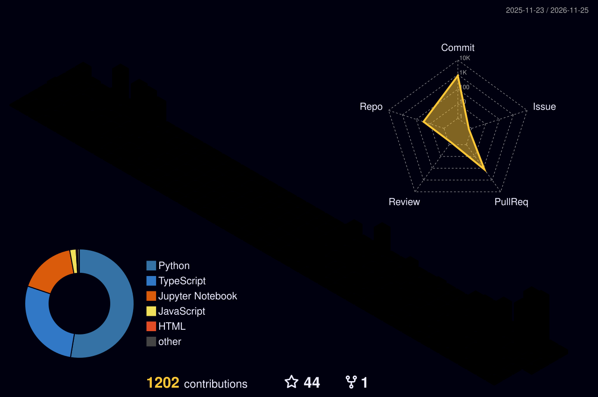

<picture>
  <source media="(prefers-color-scheme: dark)" srcset="https://raw.githubusercontent.com/brej-29/brej-29/output/pacman-contribution-graph-dark.svg"/>
  <source media="(prefers-color-scheme: light)" srcset="https://raw.githubusercontent.com/brej-29/brej-29/output/pacman-contribution-graph.svg"/>
  
</picture>

<picture>
  <source media="(prefers-color-scheme: dark)" srcset="https://raw.githubusercontent.com/brej-29/brej-29/output/github-contribution-grid-snake-dark.svg"/>
  <source media="(prefers-color-scheme: light)" srcset="https://raw.githubusercontent.com/brej-29/brej-29/output/github-contribution-grid-snake.svg"/>
  
</picture>

<b>🎓 Background and credentials</b>

 

| When | What |
|---|---|
| Sep 2026 to now | **AI Engineer, Cloud202.** Governance and safety of agentic AI on AWS (Bedrock, AgentCore) |
| ~1 yr 9 mo | **Advanced Application Engineering Analyst, Accenture.** Enterprise modernization in Java / Spring Boot + Angular for a Fortune 500 financial services client |
| 2024 | **B.E. Electronics and Communication, College of Engineering Guindy, Anna University.** CGPA 8.54. Final-year project: a wearable navigation aid for visually impaired users |

**Certifications:** AWS Machine Learning Engineer Nanodegree · Oracle Cloud Infrastructure Data Science Professional · Advanced Data Science & AI (Logicmojo) · McKinsey.org Forward Program

  
  
  
  

  

